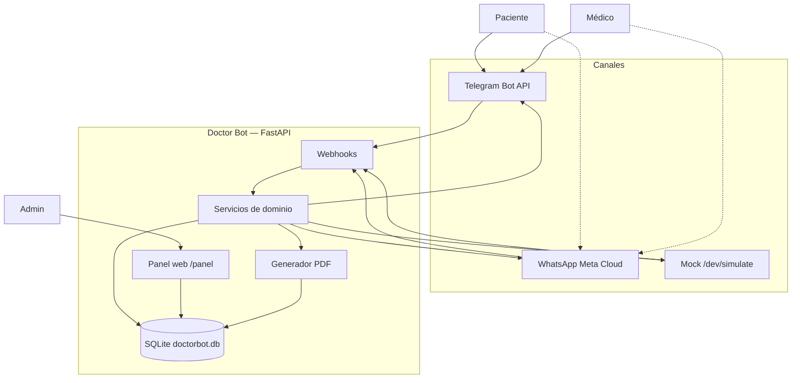
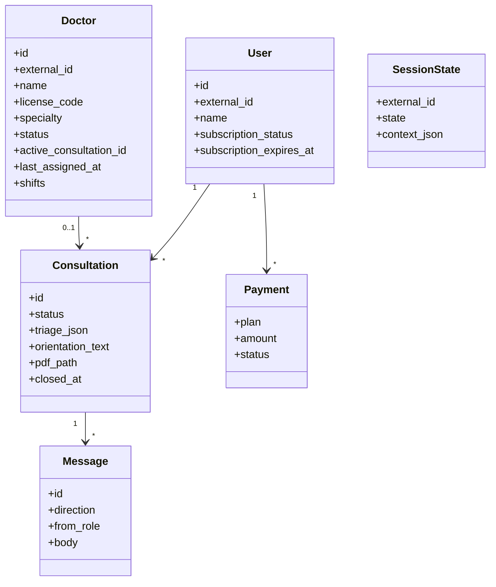
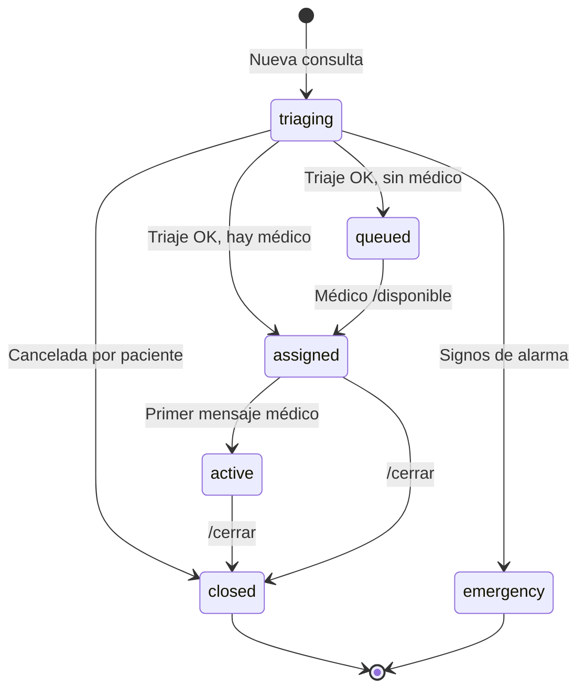
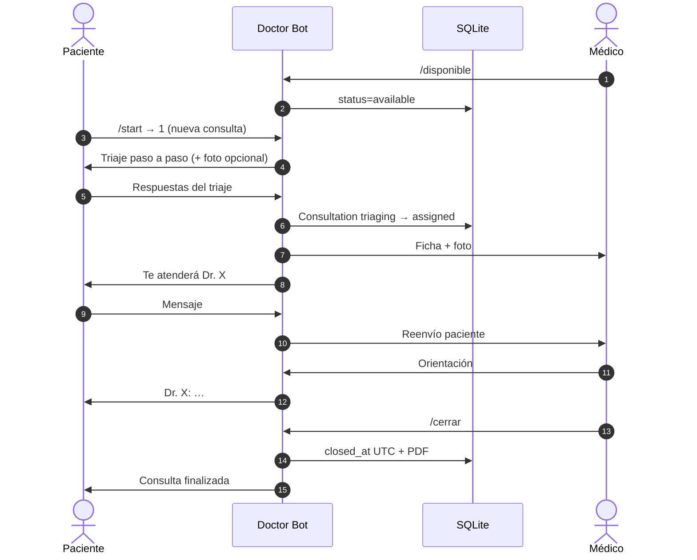
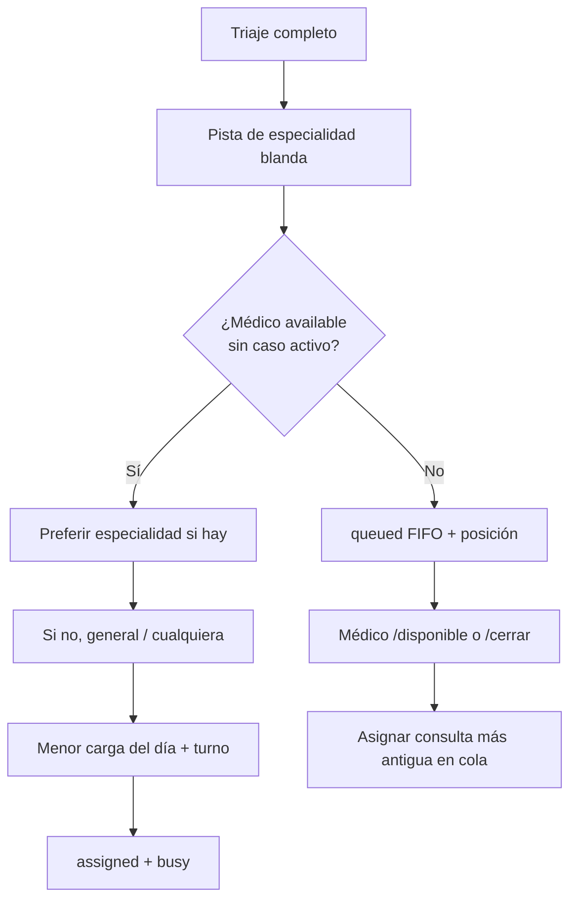
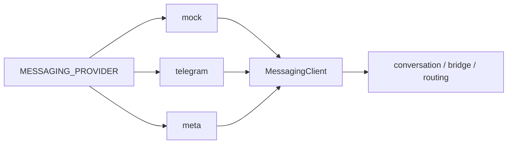

# Doctor Bot — Visión del proyecto

**Doctor Bot** es una plataforma de **teleorientación médica primaria** por mensajería (Telegram hoy, WhatsApp mañana).  
Pacientes y médicos conversan en el chat; un **panel web** centraliza la operación (consultas, médicos, pagos simulados, PDFs).

> No es un servicio de emergencias. Ante signos de gravedad se deriva al **106 SAMU**.

---

## 1. ¿De qué trata?

| Actor | Cómo interactúa |
|-------|-----------------|
| **Paciente** | Bot de Telegram/WhatsApp: menú, suscripción demo, triaje, chat con médico |
| **Médico** | Mismo bot: `/disponible`, orientación, `/cerrar` (genera PDF) |
| **Admin / demo** | Panel `http://localhost:8000/panel` |

### Capacidades principales

1. Menú y **triaje** (nombre, edad, síntoma, tiempo, foto opcional)
2. Filtro de **emergencia**
3. **Asignación** a médico disponible o **cola** FIFO
4. Puente de mensajes paciente ↔ médico
5. **Videollamada opcional** (Jitsi, misma sala por consulta; no se graba)
6. **PDF** de orientación al cerrar (hora Perú en pantalla; UTC en BD)
6. Suscripciones / pagos **simulados**
7. Recordatorios ~48 h
8. Canal intercambiable: `mock` | `telegram` | `meta`

---

## 2. Arquitectura lógica (UML — componentes)



---

## 3. Diagrama de casos de uso (UML)

```mermaid
flowchart LR
  Paciente((Paciente))
  Medico((Médico))
  Admin((Admin))

  Paciente --> UC1[Iniciar consulta / triaje]
  Paciente --> UC2[Ver estado]
  Paciente --> UC3[Suscripción simulada]
  Paciente --> UC4[Chatear con médico]
  Paciente --> UC5[Cancelar triaje incompleto]

  Medico --> UC6[/disponible /ocupado /fuera]
  Medico --> UC7[Recibir ficha + foto]
  Medico --> UC8[Orientar al paciente]
  Medico --> UC9[/cerrar → PDF]

  Admin --> UC10[Ver dashboard y consultas]
  Admin --> UC11[Agregar / editar médicos y turnos]
  Admin --> UC12[Reasignar / forzar cierre / offline]
  Admin --> UC13[Descargar PDF / recordatorios]
```

---

## 4. Modelo de dominio (UML — clases simplificado)



### Estados de consulta



### Estados del médico

```text
offline  --/disponible-->  available
available --asignación-->  busy
busy      --/cerrar----->  available
available --/ocupado---->  busy (sin nuevos)
*         --/fuera------>  offline (si no hay activa)
```

---

## 5. Flujo de una consulta (secuencia UML)



---

## 6. Asignación de médicos



1. **Horario:** si el médico tiene franjas en el panel, solo entra al sorteo automático dentro de ellas (hora Perú). Sin franjas = sin restricción. `/disponible` fuera de horario es hora extra y sí puede tomar la cola.
2. **Especialidad blanda:** se infiere del triaje (menor de 12 años → pediatría; palabras en el síntoma). Si hay un médico disponible de esa pista, se prefiere. Si no, se asigna a *general* o a cualquiera — **nunca se espera** a un especialista.
3. **Menor carga:** menos consultas *asignadas hoy* (día civil Perú).
4. **Rotación:** a igual carga, el que lleva más tiempo sin un caso (`last_assigned_at`).
5. **Cola FIFO:** si nadie está disponible *y* en horario. El paciente ve su posición. Al `/cerrar` (si sigue en horario) o `/disponible` se toma el siguiente de la cola.

---

## 7. Canales de mensajería



Un solo canal activo a la vez. Identidad unificada: `external_id` (chat_id Telegram o teléfono WA).

---

## 8. Estructura del repositorio

```text
app/
  api/          # webhooks, panel, health, simulate
  providers/    # mock, telegram, meta
  services/     # dominio (triaje, bridge, PDF, …)
  models/       # SQLAlchemy
  templates/    # panel Jinja2
scripts/        # set_telegram_webhook.ps1
storage/        # pdfs + media
tests/
PROJECT.md      # este documento
README.md       # instalación y arranque
```

---

## 9. Variables clave (`.env`)

| Variable | Rol |
|----------|-----|
| `MESSAGING_PROVIDER` | `mock` \| `telegram` \| `meta` |
| `TELEGRAM_BOT_TOKEN` | Token BotFather |
| `TELEGRAM_WEBHOOK_URL` | Opcional; si vacío se lee ngrok `:4040` |
| `SEED_DOCTOR_ID` / `SEED_DOCTOR_NAME` | Médico demo al arrancar |
| `PANEL_TOKEN` | Login del panel |
| `DATABASE_URL` | Por defecto `sqlite:///./doctorbot.db` |
| `REMINDER_AUTO` | Recordatorios 48 h en segundo plano (default true) |
| `REMINDER_POLL_SECONDS` | Cada cuánto revisa (default 900) |

Los médicos adicionales se agregan en **Panel → Médicos** (SQLite), no en el `.env`.

---

## 10. Aviso legal

Doctor Bot ofrece **orientación primaria**, no reemplaza consulta presencial ni emergencia.  
PDF orientativo — **no** es receta oficial del MINSA. Emergencias: **106**.
